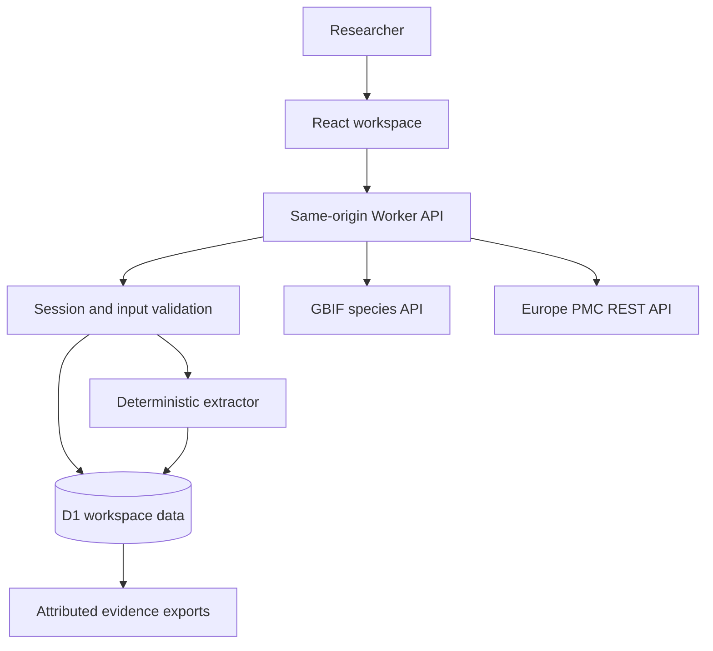
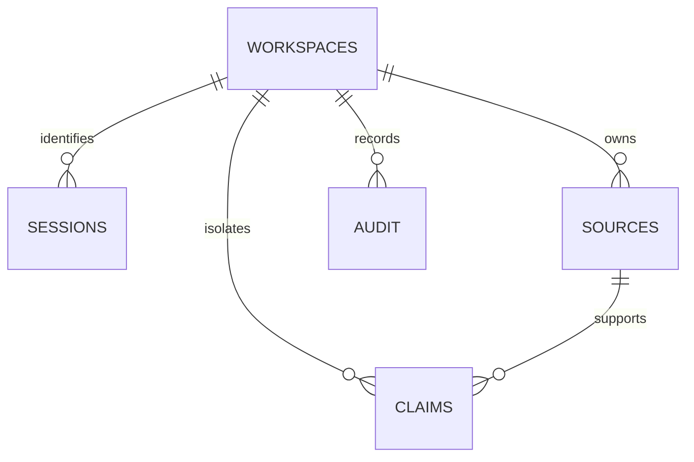

# Citeflora

An evidence review workspace for traditional medicinal plant research. Every candidate extraction retains its source passage, citation, uncertainty, and review history.

[Open Citeflora](https://citeflora.adeelfalaksher900.chatgpt.site) · [Product and architecture](docs/PRODUCT.md) · [Data permissions](docs/DATA.md) · [Security](SECURITY.md)

Built during EthnoHack 2026 for Track 1, Traditional Knowledge Mining.

## The problem

Plant names change across sources. A common name sometimes describes several species. A reported traditional use does not establish clinical effectiveness. Extracting a plant-use pair without its original context makes later review difficult.

Citeflora retains a reviewable record from the text snapshot to the extracted candidate. It preserves ambiguous names instead of silently choosing a species. Review decisions and corrected fields remain separate from the original extraction.

## What works

- Isolated research workspaces stored in Cloudflare D1, identified by a random HttpOnly browser cookie.
- A starter corpus with 43 selected table rows from two attributed CC BY papers, producing 75 candidate extractions and 18 source-reported taxa.
- Import of English text, UTF-8 text/Markdown files, and the documented six-column CSV format.
- A deterministic, versioned rule engine with exact UTF-16 offsets into unchanged source snapshots.
- Review queue with source and status filters, uncertainty flags, accepted/rejected/pending decisions, notes, and optional corrections.
- 24 dated GBIF taxonomy reference records, live lookup for other names, and Europe PMC search with licence-checked narrative imports. If live search fails, a clearly labelled one-paper reference catalogue remains available.
- Association provenance grouped by plant and use, with duplicate DOIs counted once.
- CSV, JSON, and printable HTML evidence exports, with citations, source hashes, and review state.

Acceptance means the researcher checked an extraction. It is not clinical validation. Citeflora provides no treatment advice, dosage recommendations, or plant-identification guarantee.

## Architecture





The interface uses React 19 and the Vinext app router. Cloudflare Workers run the API and extraction. D1 stores sources, candidates, sessions, and audit events. The two external data services require no API key. The shipped corpus remains inspectable when an external service is unavailable.

## Run locally

Requirements: Node.js 24 or later, Python 3 only for refreshing the research corpus, and pnpm 11.25.0 as declared in `package.json`.

```sh
git clone https://github.com/adeelfalaksher900-creator/citeflora.git
cd citeflora
corepack enable
pnpm install --frozen-lockfile
pnpm build
node --import ./scripts/sites-env.mjs ./node_modules/wrangler/bin/wrangler.js d1 execute DB --local --config dist/server/wrangler.json --persist-to .wrangler/state --file drizzle/0000_stormy_frog_thor.sql
pnpm dev
```

Open the URL printed by the development server. Local and hosted D1 databases are separate. The repository's public hosting manifest intentionally contains no live Site identity or credentials. For a new Sites deployment, register your own Site and preserve its returned identity. For standalone Cloudflare hosting, bind your own D1 database as `DB` and apply the schema migration before serving the Worker.

No secret environment variable is required for the implemented features. Local `.env*`, runtime state, dependencies, deployment output, and private credentials are excluded from version control.

## Reproduce extraction results

```sh
pnpm test
pnpm typecheck
node scripts/evaluate.mjs
python3 scripts/refresh-reference-cache.py
python3 scripts/refresh-corpus.py
```

`refresh-corpus.py` retrieves the two specified articles through the Europe PMC REST service, verifies an explicit permissive licence, expands table row spans, selects the documented taxa, and saves the normalized text and XML/content digests. It does not scrape restricted databases or republish private fieldwork. Source offsets refer to the normalized snapshot, not publisher XML.

The regression tests exercise extraction scope, ambiguity, negation, Unicode offsets, DOI deduplication, validation, spreadsheet formula escaping, session isolation, review revision conflicts, audit persistence, and HTML export escaping. API tests run the real API implementation against an in-memory SQLite adapter for D1's contract. They do not replace browser or hosted D1 checks. Developer-authored fixtures are not an independent scientific accuracy benchmark.

## CSV import

Use these exact six headings. Quote fields containing commas according to CSV rules.

```csv
Botanical name,Local name,Plant parts,Preparation,Route,Reported use
```

The interface downloads an empty template. Narratives use sentence scope. Table inputs use row scope. Fields with several plants in a narrative passage remain unassigned candidates requiring human review.

## Limits

- English rule-based processing with a bounded name list and known-genus fallback. Complex grammar, pronouns, and many names are unsupported.
- A maximum of 80,000 source characters and 90 proposed records per import. Truncation is marked. Workspaces allow up to 20 sources and 500 candidates.
- A 30-day browser cookie, without user accounts or cross-device synchronization. Export for portable access.
- The reference catalogue contains one licensed narrative snapshot, not an index of all literature. Its keyword fallback is broad and explicitly labelled. Automatic imports exclude tables and figures and retain at most 75,000 characters.
- GBIF matches current taxonomy, not the identity of a historical specimen. Its confidence score is a name-match score only.
- Literature imports support explicit CC BY 4.0 or CC0 licences. The user reviews source classification and context.
- Exports include the latest 200 audit events. There is no claim of expert, clinical, or large-scale validation.

## Authorship and third-party work

The project uses AI-assisted research, development, and testing. The source and submission disclose that assistance. Human team members retain responsibility for project selection, review, and submission. Specific individual programming or research contributions are not invented.

The Sites Vinext starter and its maintained build/connector scaffolding predate this project. React, Vinext, Vite, Drizzle, Lucide, Cloudflare tools, and other packages remain under their respective licences. Project-specific work includes the extraction engine, validation and session API, D1 schema, review interface, evidence exports, corpus preparation, tests, and project documentation.

New project code is MIT-licensed. Research excerpts retain the papers' CC BY terms and original author attribution. Geist retains the SIL Open Font License. See [data permissions](docs/DATA.md).

## Contributing

Open an issue or pull request with a reproducible case. Changes require maintainer review. Keep source snapshots immutable, preserve uncertainty and attribution, and add regression coverage when changing extraction or authorization behavior. Never commit patient information, restricted community knowledge, or credentials.
