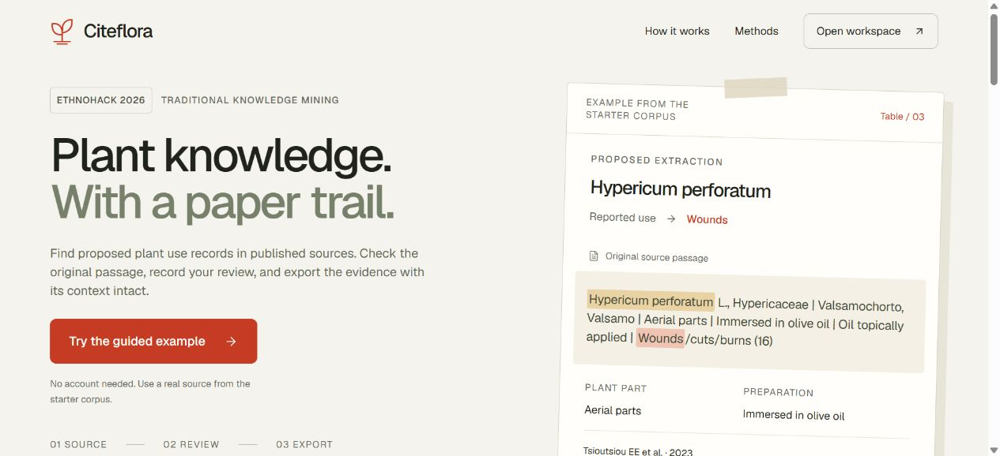
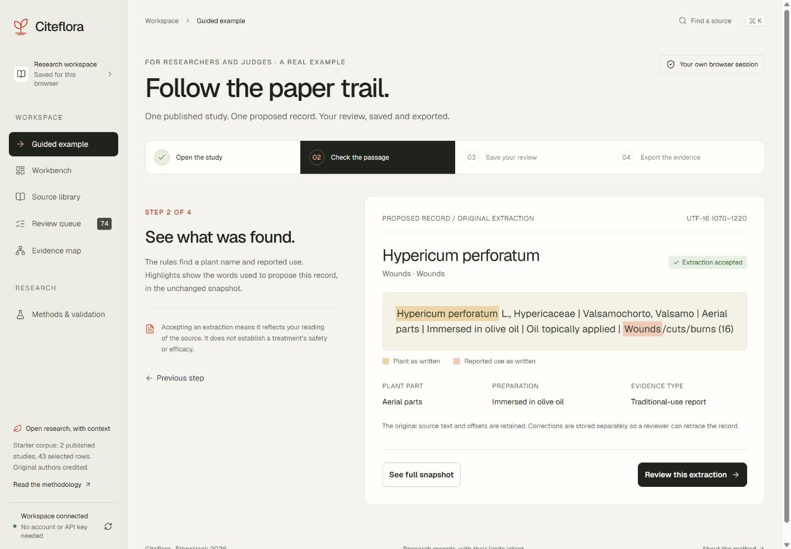
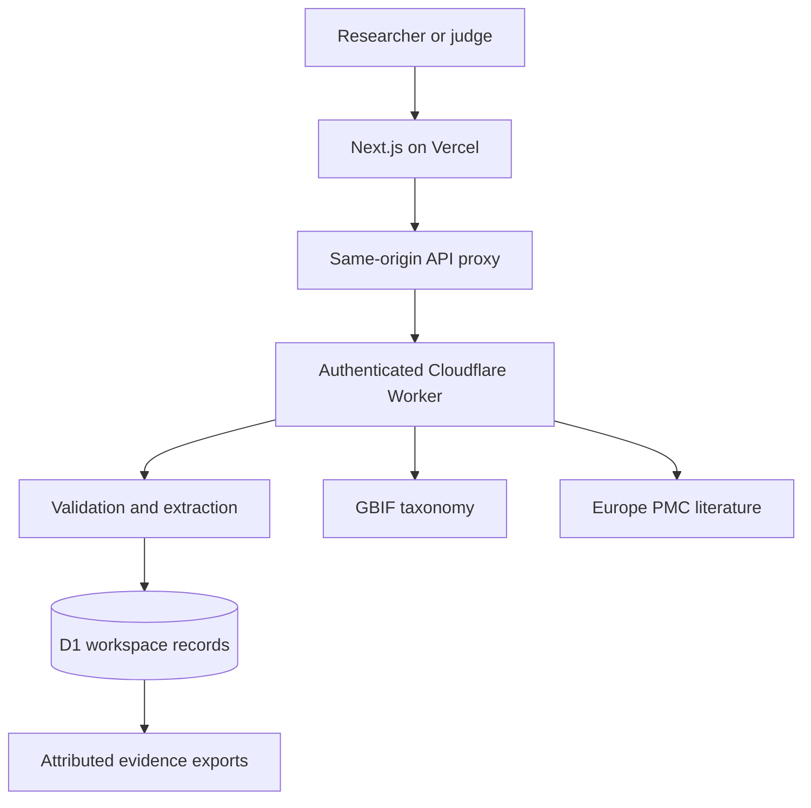
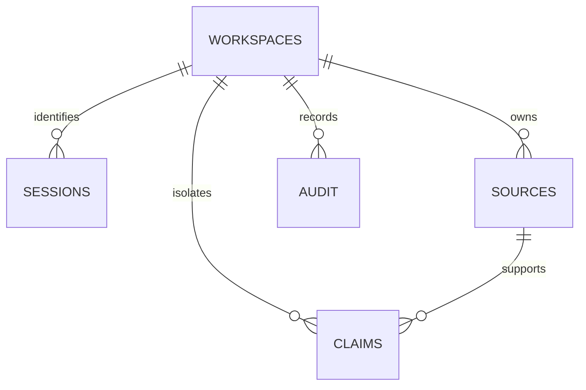

# Citeflora

**Plant knowledge. With a paper trail.**

Citeflora helps researchers turn published plant-use reports into records they can check. Find a proposed record, read its original passage, save a review, and export the evidence with its citation and uncertainty intact.

[Open Citeflora](https://citeflora.vercel.app) · [Product and architecture](docs/PRODUCT.md) · [Data permissions](docs/DATA.md) · [Security](SECURITY.md) · [Verification](docs/VERIFICATION.md)

Built during EthnoHack 2026 for Track 1, Traditional Knowledge Mining.



## Try the complete workflow

Judges and first-time visitors can choose **Try the guided example** without creating an account or supplying an API key:

1. **Open the study.** Inspect the Pelion study's citation, CC BY licence and selected-table scope.
2. **Check the passage.** Follow the proposed *Hypericum perforatum* and wounds record to its highlighted words in the unchanged source snapshot.
3. **Save your review.** Accept, reject or keep the extraction pending. Add notes or corrections as needed. The next step becomes available after the server saves the new revision.
4. **Export the evidence.** Download a formatted PDF, DOCX or DOC report containing the saved review and source trail. Completion follows a successful export response.

Researchers can instead choose **Add a research source** to import permitted text, inspect its candidates, and build their own collection. The guided example uses the same real review and export features as the workbench.



## Why keep the source attached?

Plant names change across sources. A common name may describe several species. Extracting a plant-use pair without its original wording makes later review difficult, and a reported traditional use does not establish clinical effectiveness.

Citeflora preserves the passage, citation, preparation, regional context and uncertainty. Review corrections remain separate from the original extraction. Acceptance records an extraction review, not clinical validation. The app provides no treatment advice, dosage recommendations or plant-identification guarantee.

## What works

- Isolated research workspaces persisted in Cloudflare D1 and identified by an HttpOnly browser session cookie.
- A starter corpus with 43 selected table rows from two attributed CC BY papers, producing 75 candidates and 18 source-reported taxa.
- Import of text-based PDF, Word DOC/DOCX, UTF-8 TXT/Markdown, HTML, a single-source JSON object, and the documented six-column CSV format. Files are converted locally before the extracted text is reviewed and saved.
- A versioned deterministic rule engine with exact UTF-16 offsets into unchanged snapshots and SHA-256 digests.
- A review queue with filters, uncertainty flags, notes, optional corrections and revision checks.
- 24 dated GBIF taxonomy reference records, live lookup for other names, and Europe PMC search with licence-checked narrative imports. A clearly labelled one-paper catalogue remains available if live search fails.
- An evidence map of positive reported associations, with duplicate DOIs counted once. Negative, speculative, rejected and unassigned associations are excluded.
- Formatted PDF, DOCX and genuine legacy DOC downloads with aligned fields, source citations, original passages, uncertainty and separate review corrections. PDF embeds Unicode fonts; DOCX contains native editable tables and page fields. The compatibility API retains CSV, JSON and HTML for reproducibility.

## Architecture





The public interface uses standard Next.js 16, React 19 and TypeScript on Vercel. Its server API proxy forwards allowlisted requests to `https://citeflora-api.adeelfalaksher900.workers.dev`. The standalone Worker owns sessions, extraction, database writes and external research requests. It requires a secret shared with the Vercel server; the browser never receives a privileged API key.

The proxy validates exact-origin JSON writes, forwards only `citeflora_session`, and derives a trusted rate-limit bucket from the platform client address. D1 queries are scoped to the session workspace. Reviews check the expected revision and write the decision and audit event together. See [SECURITY.md](SECURITY.md) for boundaries and limitations.

## Run and deploy

Use Node.js 24 and the pnpm version declared in `package.json`. Python 3 is needed only for research preparation and hosted verification scripts.

```sh
git clone https://github.com/adeelfalaksher900-creator/citeflora.git
cd citeflora
corepack enable
pnpm install --frozen-lockfile
```

### Vercel interface and Cloudflare API

An operator needs their own Cloudflare Worker and D1 database. Replace the account and database identifiers in `worker/api.wrangler.jsonc` with your resources, bind the database as `DB`, and apply `drizzle/0000_stormy_frog_thor.sql` before serving requests.

```sh
pnpm build:api
pnpm exec wrangler d1 execute DB --remote --config worker/api.wrangler.jsonc --file drizzle/0000_stormy_frog_thor.sql
pnpm exec wrangler deploy --config worker/api.wrangler.jsonc
pnpm exec wrangler secret put CITEFLORA_PROXY_SECRET --config worker/api.wrangler.jsonc
```

Set a random shared secret of 32–256 base64url characters through the secret command's prompt. Configure these server-only variables in Vercel, using the same secret in both services:

| Variable | Purpose |
| --- | --- |
| `CITEFLORA_API_URL` | Your HTTPS `workers.dev` API origin, with no path or query |
| `CITEFLORA_PROXY_SECRET` | Shared server secret matching the Worker secret |

Do not prefix either variable with `NEXT_PUBLIC_` or commit its value. The proxy rejects an incomplete configuration. Europe PMC and GBIF require no service API key for these features. End users and judges need no account or key; operators still configure the deployment secret.

Use `pnpm build:vercel` as the Vercel build command, with Next.js selected as the framework. For local Next.js development, put the operator configuration in an ignored `.env.local` and use your deployed API:

```sh
pnpm dev:vercel
pnpm build:vercel
pnpm start:vercel
```

The API is built separately with `pnpm build:api`. It retains the `cloudflare:workers` runtime import for Workers deployment.

### Optional Sites development

The original Sites/Vinext path remains supported locally. It uses a local D1 database rather than the Vercel proxy:

```sh
pnpm build:sites
node --import ./scripts/sites-env.mjs ./node_modules/wrangler/bin/wrangler.js d1 execute DB --local --config dist/server/wrangler.json --persist-to .wrangler/state --file drizzle/0000_stormy_frog_thor.sql
pnpm dev
```

`pnpm build` remains an alias for this optional Sites build. Local and hosted databases are separate. The public hosting manifest contains no live Site identity or credentials. Register your own Site before a new Sites deployment.

## Verify the implementation

```sh
pnpm test
pnpm typecheck
pnpm lint
pnpm build:vercel
pnpm build:api
node scripts/evaluate.mjs
python3 scripts/verify-hosted.py --url https://citeflora.vercel.app
```

The 67 developer-authored checks cover extraction scope, ambiguity, negation, Unicode offsets, DOI deduplication, validation, spreadsheet escaping, session isolation, revision conflicts, audit persistence, exports and the proxy/Worker trust boundary. API checks execute the real API against an in-memory SQLite adapter for D1. These do not replace browser or hosted tests and are not an independent scientific accuracy benchmark. See the dated [verification report](docs/VERIFICATION.md).

To refresh the attributed material:

```sh
python3 scripts/refresh-reference-cache.py
python3 scripts/refresh-corpus.py
```

The corpus script retrieves the specified articles through Europe PMC, verifies a permissive licence, expands table row spans, selects the documented taxa, and saves normalized snapshots and digests. Offsets refer to these snapshots, not publisher XML.

## CSV import

Use these exact six headings. Quote fields containing commas according to CSV rules.

```csv
Botanical name,Local name,Plant parts,Preparation,Route,Reported use
```

The interface downloads an empty template. Narratives use sentence scope; tables use row scope. Several plants in a narrative passage produce unassigned candidates requiring human review.

## Limits

- English rules have a bounded name list and known-genus fallback. Complex grammar, pronouns and many names are unsupported. This is not a trained AI model.
- Imports allow 80,000 source characters, 6,000 characters per sentence/table-row passage, and 90 proposed records. Truncation is marked. Workspaces allow up to 20 sources and 500 candidates.
- A browser session lasts 30 days. There are no accounts, account recovery or cross-device synchronization. Workspaces are tied to the hosting domain; exports provide portable access.
- The one-paper catalogue is not a literature index. Narrative preparation excludes tables and figures and retains at most 75,000 characters.
- Automatic literature imports support explicit CC BY 4.0 or CC0 terms. Users review classification and context. Publication licences do not grant rights to restricted community knowledge.
- GBIF suggests current taxonomy. Its score is not evidence of efficacy, safety or historical identity.
- No expert, clinical or independent accuracy validation is claimed. See [verification limitations](docs/VERIFICATION.md) for incomplete checks.

## Authorship and third-party work

The project uses significant ChatGPT/Codex assistance for research, design, development and verification. Human team members retain responsibility for review and submission. Specific individual programming or research contributions are not invented.

The maintained Sites/Vinext starter and build/connector scaffolding predate this project. The public deployment uses standard Next.js. React, Next.js, Vinext, Vite, Drizzle, Lucide, Cloudflare tools and other dependencies retain their licences. Project-specific work includes extraction, corpus preparation, validation/session API, D1 schema, proxy boundary, guided review interface, exports, tests and documentation.

New code is MIT-licensed. Excerpts retain their papers' CC BY terms and author attribution. Geist retains the SIL Open Font License. See [data permissions](docs/DATA.md).

## Contributing

Open an issue or pull request with a reproducible case. Changes require maintainer review. Keep snapshots immutable, preserve uncertainty and attribution, and add regression coverage for extraction or authorization changes. Never commit patient information, restricted community knowledge or credentials.

## Document files

The upload flow accepts PDF, DOC, DOCX, CSV, TXT/Markdown, HTML and JSON. PDF and Word files are limited to 5 MB. Other files are limited to 250 KB. Extracted text is capped at 80,000 characters, and PDFs at 100 pages. Scanned PDFs require OCR before import. Password-protected or damaged files fail with an explicit message. Converted text, reading order and attribution must be checked before import; the original binary file is not uploaded or retained.

JSON input accepts one source object with a string `text` field and optional `title`, `authors`, `year`, `region`, `doi`, `url`, `licence` and `format` fields. Import permission must still be confirmed in the form. Multi-source archives are rejected to preserve individual citations. HTML scripts and styles are discarded without loading remote resources.

Report fonts and the PDF.js worker are copied from pinned dependencies before development or production builds. Their licences are served beside those assets. The legacy DOC reader/writer is attributed in `lib/vendor/jsdoc/PROVENANCE.md`, with its 0BSD licence and local reader bounds documented. Document generation runs in the browser from a fresh, authenticated workspace export. No source material is sent to a third-party conversion service.
