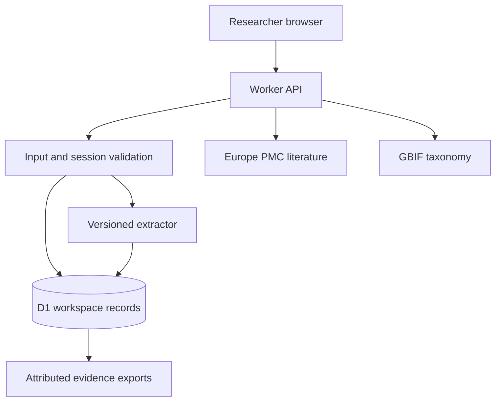

# Citeflora product and technical plan

Created 3 November 2026 for EthnoHack, Track 1: Traditional Knowledge Mining.

## Problem and choice

An extracted medicinal-plant relationship is difficult to audit when its source passage, plant identity, preparation, and research context disappear. Citeflora is a research review workspace. It records reported traditional uses, not treatment recommendations.

Five directions were compared before implementation:

| Direction | Value | Main limitation | Decision |
| --- | --- | --- | --- |
| Plant identification from photographs | Useful field workflow | Requires validated regional images and a trained model | Excluded |
| Natural-product target screening | Technical drug-discovery workflow | Meaningful validation needs specialist assays and datasets | Excluded |
| Medicinal-plant conservation map | Relevant sustainability problem | Occurrence bias makes threat claims unreliable | Excluded |
| Patient-facing herbal chatbot | Easy access to information | Clinical safety and evidence quality are difficult to establish | Excluded |
| Passage-linked extraction and review | Auditable research records with uncertainty preserved | English rules have bounded recall | Selected |

The differentiator is a reviewable chain from an unchanged source snapshot to each candidate plant-use record. Ambiguous common names and genus-level mentions remain explicit. Duplicate citations do not become independent evidence.

## Acceptance criteria

1. A new visitor starts an isolated, server-persisted research workspace without an account.
2. The initial corpus contains selected rows from two explicitly licensed research papers. It is labelled as a starter corpus, not an exhaustive dataset or new fieldwork.
3. Users import their own permitted English text or supported UTF-8 files with title, citation, licence, and regional context.
4. A versioned deterministic extractor proposes plant-use records and preserves UTF-16 source and entity offsets.
5. Users inspect the source passage and record accepted, rejected, or pending extraction decisions, notes, and optional identity resolutions.
6. GBIF name matching is an on-demand external taxonomy suggestion. Its name-match score is never a probability of medical efficacy or historical identification.
7. A literature search queries Europe PMC, with references and external links. API failures are shown honestly.
8. An evidence map groups claims by plant and use, deduplicating source DOIs. It shows associations, not causal or clinically validated relationships.
9. CSV, JSON, and a printable HTML evidence report contain source attribution, hashes, uncertainty, review decisions, and audit history.
10. Core extraction, tenant isolation, revision conflicts, input validation, and real user journeys are verified.

## Architecture

The app uses the Sites Vinext/React starter on Cloudflare Workers, with Cloudflare D1. Supabase would add external project and authentication dependencies. Firebase would add a separate document-data and identity layer. D1 fits the bounded relational review workflow and the existing Worker deployment.

Browser UI calls same-origin API routes. The server owns sessions, validation, extraction, database writes, and fixed-host external API requests. No privileged key is delivered to the browser. A random HttpOnly session cookie identifies a workspace, and only its SHA-256 hash is stored. Each query is scoped to that workspace. Review writes use revision checks and an audit event in one batch.

## Data model

Workspaces own sessions, sources, claims, and audit events. Sources retain immutable text and a content digest. Claims point to a source and retain extraction offsets, flags, and a review revision. Rate limits contain short-lived hashed keys. Schema changes are migration-owned.

## Risks and limits

English rule-based extraction has limited vocabulary and relation scope. It is not a learned medical model. Same-sentence co-occurrence is a candidate relationship requiring review. No clinical validation is claimed. Historical names do not establish species identity. A source licence does not grant rights to restricted community knowledge. Users should import public or explicitly permitted research material, never private patient records or restricted traditional knowledge.

The workspace follows one browser session, with a 30-day cookie. There are no user accounts or cross-device sync promises. Exports are the portable record. External services may be unavailable. Initial evaluation is a small developer-authored fixture set, not an independent research benchmark.

## Design decisions

The primary question is: which extraction should I review next, and what passage supports it? The source passage and candidate sit beside one another. The signature visual is the claim's source-to-plant-to-use lineage, backed by real records. The design-taste-frontend app direction is Achromatic ledger, seed 750826046, with a cool grey ground, a small blue data accent, and Geist type. Mobbin references were Sprig's study search flow and Perplexity's academic search flow. Their navigation, filters, and reading hierarchy informed an original layout. No reference artwork or template code is copied.

## Hackathon constraints

Official pages checked: overview, complete rules, resources, schedule, updates, project gallery, and both current discussion threads. The gallery is not published and no previous EthnoHack winners were found. Related GBIF Ebbe Nielsen winners emphasize practical workflows, data quality, and reproducibility; they are comparisons, not EthnoHack winners.

Seven judging criteria are published: scientific relevance, innovation, technical implementation, data science quality, feasibility, impact, and presentation. No numerical weights are currently published. There is no required sponsor technology.

Submission deadline shown by Devpost: 8 November 2026, 09:00 UTC, 14:00 Pakistan time. Teams must have 2–5 registered members. An organizer discussion also asks teams to register in Discord on the first day. Registration timing and Discord team status are not inferred from an existing Devpost registration.

Required submission materials: Devpost page, public source repository, documentation and data licences, video of at most 10 minutes, and deck of at most 10 slides. AI-assisted development must be disclosed accurately. The Devpost draft is saved for user review only. Full video and 15-image gallery production are deferred until user approval. A 3:2 thumbnail is prepared before review.
