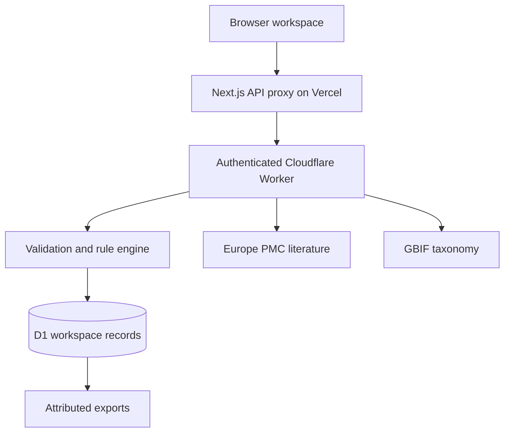

# Citeflora product and technical plan

Updated 3 November 2026 for EthnoHack, Track 1: Traditional Knowledge Mining.

## Problem and choice

A plant-use relationship becomes difficult to audit when its passage, identity, preparation and research context disappear. Citeflora is a review workspace for published traditional knowledge. It helps researchers organize reported uses with an inspectable source trail. It does not recommend treatments.

Five directions were compared before implementation:

| Direction | Value | Main limitation | Decision |
| --- | --- | --- | --- |
| Plant identification from photographs | Useful field workflow | Requires validated regional images and a trained model | Excluded |
| Natural-product target screening | Technical drug-discovery workflow | Meaningful validation needs specialist assays and datasets | Excluded |
| Medicinal-plant conservation map | Relevant sustainability problem | Occurrence bias makes threat claims unreliable | Excluded |
| Patient-facing herbal chatbot | Easy access to information | Clinical safety and evidence quality are difficult to establish | Excluded |
| Passage-linked extraction and review | Auditable records with uncertainty preserved | English rules have bounded recall | Selected |

The differentiator is the chain from an unchanged snapshot to a proposed record, a human decision and an attributed export. Common-name ambiguity and genus-level mentions remain explicit. Duplicate citations do not become independent evidence.

## People and workflow

Researchers, students and curators can add permitted English sources, inspect candidates, record uncertainty or corrections, and export a collection for further work. The useful output is a reviewable research record, not an answer about whether a remedy works.

Judges and first-time visitors use **Try the guided example** at [citeflora.vercel.app](https://citeflora.vercel.app). No end-user account or API key is required. The guide uses a real record from the Pelion starter paper:

| Step | User action | Actual result |
| --- | --- | --- |
| Open the study | Inspect citation, licence, regional context and selected-table scope | Source record and unchanged text snapshot |
| Check the passage | Read the proposed *Hypericum perforatum* and wounds relationship | Highlighted plant and use words at UTF-16 span 1070–1220 |
| Save your review | Accept, reject or keep pending; optionally add notes or corrections | New server revision and audit event; guide advances after success |
| Export the evidence | Choose CSV, JSON or HTML | Workspace export with saved review states; completion follows a successful response |

The target remains selected after a decision. Replaying the guide does not reset reviews. The full workbench retains source search, filters, imports, taxonomy checks, evidence mapping and exports. The guide adds a clear route through these capabilities.

## Acceptance criteria

1. Explain the product and the next useful action before showing a populated workbench.
2. Create an isolated, server-persisted workspace without an end-user account.
3. Label the two-paper, 43-row starter clearly. Its 18 source-reported taxa and 75 candidates are not an exhaustive dataset or new fieldwork.
4. Import permitted English text and supported UTF-8 files with citation, permission basis and context.
5. Preserve snapshots, SHA-256 digests and exact UTF-16 source/entity offsets.
6. Record accepted, rejected or pending decisions with separate corrections, notes, revisions and audit history.
7. Present GBIF as a taxonomy suggestion. Its score must not represent efficacy or historical identification probability.
8. Distinguish live Europe PMC results from dated fallback material and check supported licences before narrative preparation.
9. Deduplicate DOIs and exclude negative, speculative, rejected and unassigned records from the positive map.
10. Export attribution, uncertainty, original/reviewed fields, spans and review state. JSON and HTML include the latest 200 audit events.
11. Verify isolation, the hosting trust boundary, conflicts, safe exports and public API workflows. Record browser and scientific validation separately.

## Architecture and deployment

The interface at `https://citeflora.vercel.app` runs standard Next.js 16 and React 19 on Vercel. Browser requests remain same-origin through its API proxy. The standalone API at `https://citeflora-api.adeelfalaksher900.workers.dev` runs on Cloudflare Workers with persistent D1 binding `DB`.

The proxy validates exact-origin JSON writes, an endpoint allowlist and bounded bodies. It forwards only the application session cookie, authenticates with a server secret, and supplies a rate-limit bucket derived from the Vercel platform client address. The Worker rejects unauthenticated callers and untrusted bucket values. Privileged values are not sent to the browser.

Operators configure `CITEFLORA_API_URL` and `CITEFLORA_PROXY_SECRET` in Vercel, with the matching secret in the Worker. End users need neither. Research requests use fixed Europe PMC and GBIF hosts. D1 statements use bound values and workspace scoping. Review changes and audit events share an atomic batch with expected-revision checks.

D1 retains the bounded relational workflow without adding accounts. Supabase and Firebase were considered but would add identity and service dependencies beyond the current single-browser workspace. Sites/Vinext development remains optional; Vercel is the public entry point.

## Data model

Workspaces own sessions, sources, claims and audit events. Session tokens have 256 bits of randomness; only their SHA-256 digests are stored. Sources retain immutable text and a digest. Candidates retain spans, flags and review revisions. Corrections sit separately from original fields. Rate limits use short-lived hashed keys. Schema changes are migration-owned.

## Design decisions

The entry point uses an editorial research fieldbook: warm paper surfaces, carbon ink, a vermilion action accent and strong Geist typography. The real attributed passage is the main visual, explaining the input and output. The workbench carries the same hierarchy and leads with source review rather than unexplained metrics.

Mobbin references included Mintlify onboarding and Sana's adding-source flow. Progressive disclosure, action hierarchy and the transition from entry point to a task informed an original implementation. No reference artwork or proprietary assets are copied. Native mobile, macOS and molecular-discovery features are outside this web product.

## Risks and limits

The deterministic English engine has bounded vocabulary and relation scope. It is not a trained AI model. Narrative co-occurrence without a supported use relation remains uncertain. Adverse-effect contexts and mixed polarity stay out of the positive map. Negation rules are conservative and incomplete, historical names do not establish specimen identity, and abbreviations may need the paper's own key. No clinical or independent expert validation is claimed.

The browser session expires after 30 days. There are no accounts, recovery or cross-device synchronization. Exports are portable records. External services may fail. Publication licences do not grant rights to restricted community knowledge. Only public or explicitly permitted material belongs in this workspace.

## Hackathon and submission boundaries

Recorded official research covers the overview, complete rules, resources, schedule, updates, gallery and discussion threads. No previous EthnoHack winners were found. Related GBIF Ebbe Nielsen projects are comparisons, not EthnoHack winners.

The seven published criteria are scientific relevance, innovation, technical implementation, data science quality, feasibility, impact and presentation. No numerical weights were published in the checked material. No mandatory sponsor technology was identified. These are recorded requirements, not a prediction of judges' scores.

The recorded deadline is 8 November 2026, 09:00 UTC, 14:00 Pakistan time. Teams require 2–5 registered members. First-day Discord registration, current team count and individual contributions remain for the team to verify; an existing Devpost registration does not establish them.

Required materials include a Devpost page, public repository, documentation/data licences, a video of at most 10 minutes and a deck of at most 10 slides. AI assistance must be disclosed accurately. The title and tagline are saved as a draft. The details form requires a video URL before saving, so the prepared story remains in [DEVPOST.md](DEVPOST.md). No video URL is invented and no final submission has been performed.

The 3:2 cover and eight-slide editable deck/PDF now show the revised interface and Vercel deployment. The user authorized a real product video and 15-image gallery after the live audit and fixes. Production is in progress; final submission remains with the team.
